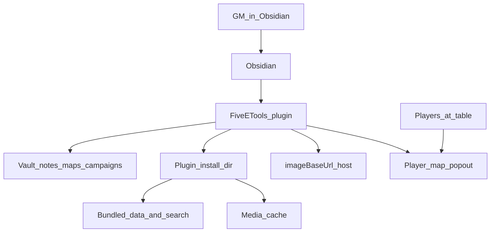
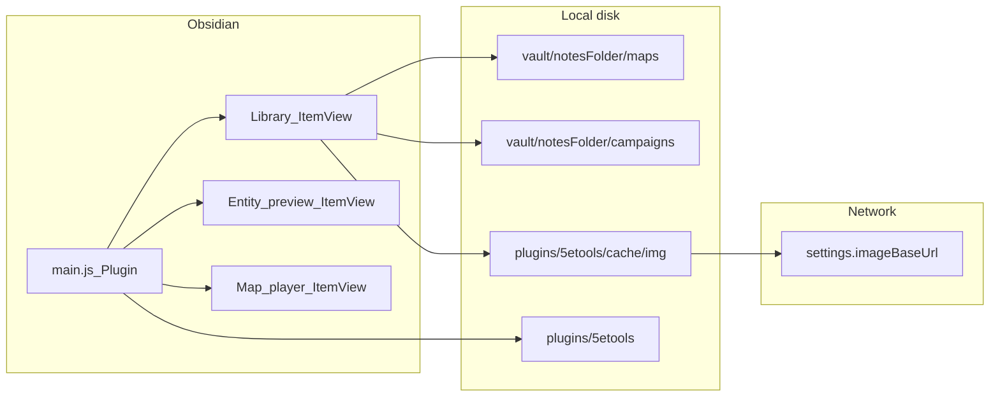
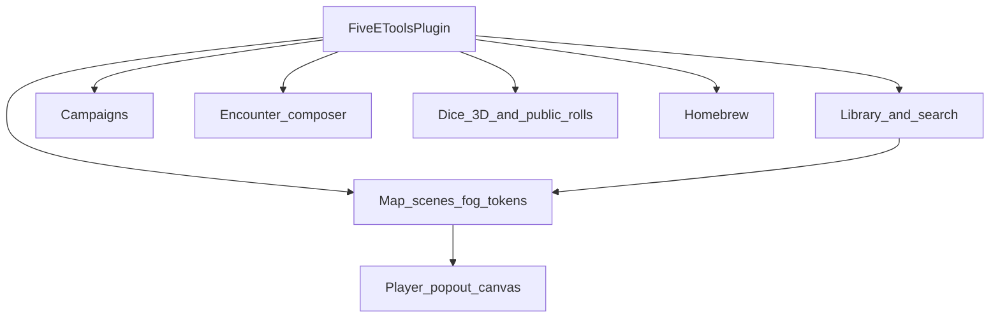

# System architecture

## Context

The Obsidian plugin embeds a slice of 5etools (search index, entity JSON, fluff) and adds GM tools: library browsing, battle maps with fog and tokens, campaigns, encounters, and dice. Library, loot, campaigns, and encounters run on desktop and mobile. Bundled JSON and the image cache use the vault adapter ([ADR 0006](adr/0006-vault-adapter-data.md)). Map scenes, tokens, and the player window still use the desktop filesystem.

## Containers

## Runtime roots (do not confuse)

| Root | Path | Used for |
|------|------|----------|
| Plugin install | `plugin.manifest.dir` (vault-relative) | Bundled `data/`, `search/`, plugin `cache/` via `vault.adapter` |
| Configured 5etools root | `configureFiveEToolsRoot(plugin)` → that dir plus `/` | Entity JSON loader (`getConfiguredRoot()`) |
| Desktop plugin dir | `getPluginDir(plugin)` / `getConfiguredAbsoluteRoot()` | Map files and the 3D dice bundle. Empty on mobile |
| Vault base | `FileSystemAdapter.getBasePath()` | Desktop scenes under `{notesFolder}/maps` |
| Git checkout | `D:/projecten/5etools` | Source + `node/build-obsidian.js` only; **not** read at runtime |

If a generated file (e.g. `gendata-maps.json`) is missing at runtime, fix the build allowlist and reinstall—editing the git tree alone does not update the vault plugin.

## Feature areas

- **Library / search** — nav from `LIBRARY_NAV`, elasticlunr index, entity render via 5etools host. JSON comes from the vault adapter.
- **Map** — desktop: vault scenes, layers, fog masks, scene-level tokens, GM canvas + player bitmap draw. On mobile the map tools show a notice.
- **Campaigns / encounters** — vault markdown and encounter store.
- **Dice** — optional 3D dice; public rolls can target the player window document.
- **Homebrew** — vault brew files indexed into search.

## Build pipeline

`node/build-obsidian.js` esbuilds `obsidian/main.js` → `build/obsidian/main.js`, copies allowlisted `data/` (including `gendata-maps.json`) and `search/`, then optionally installs into vaults listed in `FIVEETOOLS_DEV_VAULTS`.

Content updates from the upstream mirror use `npm run sync:upstream-data` (only `data/` + `search/index.json`), then the same Obsidian build to refresh the vault plugin. See [ADR 0005](adr/0005-upstream-data-sync.md).
