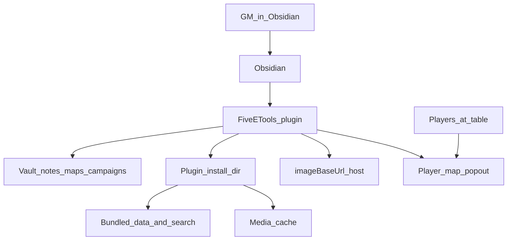
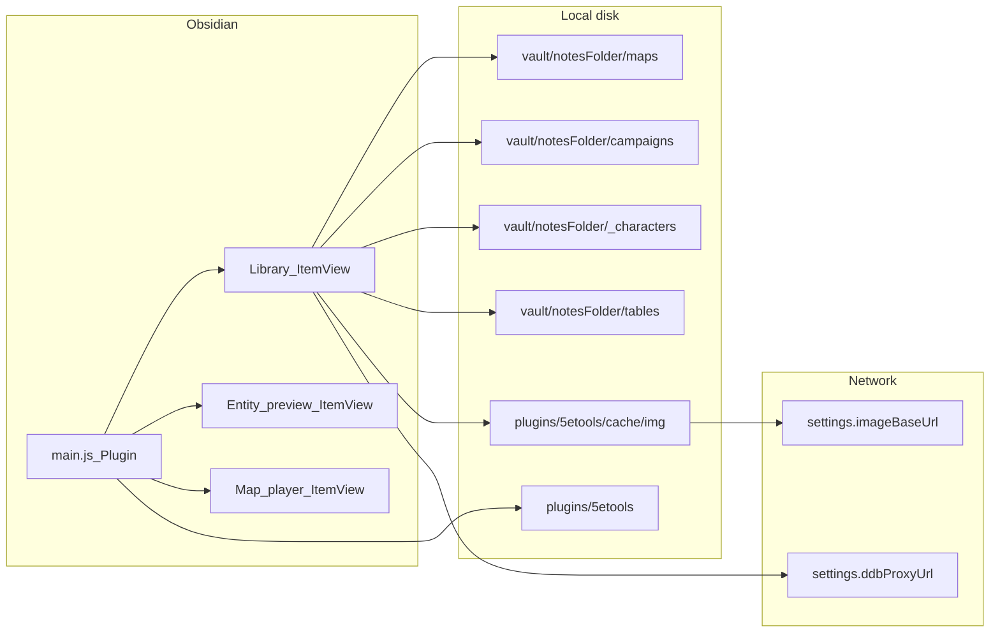
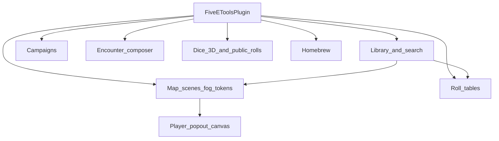

# System architecture

## Context

The Obsidian plugin embeds a slice of 5etools (search index, entity JSON, fluff) and adds GM tools: library browsing, battle maps with fog and tokens, campaigns, encounters, roll tables, and dice. Library, loot, roll tables, campaigns, and encounters run on desktop and mobile. Bundled JSON and the image cache use the vault adapter ([ADR 0006](adr/0006-vault-adapter-data.md)). Map scenes, tokens, and the player window still use the desktop filesystem.

## Containers

## Runtime roots (do not confuse)

| Root | Path | Used for |
|------|------|----------|
| Plugin install | `plugin.manifest.dir` (vault-relative) | Bundled `data/`, `search/`, plugin `cache/` via `vault.adapter` |
| Configured 5etools root | `configureFiveEToolsRoot(plugin)` → that dir plus `/` | Entity JSON loader (`getConfiguredRoot()`) |
| Desktop plugin dir | `getPluginDir(plugin)` / `getConfiguredAbsoluteRoot()` | Map files and the 3D dice bundle. Empty on mobile |
| Vault base | `FileSystemAdapter.getBasePath()` | Desktop scenes under `{notesFolder}/maps` |
| Git checkout | `D:/projecten/5etools` | Source + `node/build-obsidian.js` only; **not** read at runtime |

If a generated file (e.g. `gendata-maps.json`) is missing at runtime, fix the build allowlist and reinstall—editing the git tree alone does not update the vault plugin.

## Feature areas

- **Library / search** — nav from `LIBRARY_NAV`, elasticlunr index, entity render via 5etools host. JSON comes from the vault adapter.
- **HEIC paste** — optional: HEIC/HEIF pasted or dropped into notes convert to JPEG via bundled `heic/heic2any.js`, then embed as a normal attachment.
- **Map** — desktop: vault scenes, layers, fog masks, scene-level tokens, GM canvas + player bitmap draw. On mobile the map tools show a notice.
- **Campaigns / encounters** — vault markdown and encounter store. A campaign player note can link a shared character with frontmatter `character: {ddbId}` ([ADR 0007](adr/0007-ddb-characters.md)).
- **Characters** — Player → Characters imports a public D&D Beyond character through `settings.ddbProxyUrl` into `{notesFolder}/_characters/{id}.md`. Refresh fetches that id again and keeps local table edits in `snapshot.play` (HP, conditions, prepared spells, hit dice, coins, and gear). The raw payload is not stored.
- **Roll tables** — paste import (markdown / TSV / numbered lists) into `{notesFolder}/tables/*.md` (Atlas-style `## Name` + table). Tools → Roll tables browses and rolls; shared result cards also render loot hits. Resolvable item names still open via `openPreview`. Die notations in results/preview (`1d20`, `2d6+3`, …) are clickable rollers via `dice-roll.js` (not auto-rolled).
- **Dice** — optional 3D dice; public rolls can target the player window document. A roll marked private on the Table tool stays on the DM screen. Otherwise, when the Table window is open, the same 3D dice and result popup also play there.
- **Table** — Tools → Table. A popout that is not the map player window ([ADR 0008](adr/0008-table-window.md)). One image fills that window until it is cleared. The grouped initiative roster and public dice sit on top of the image. The DM adds creatures, encounters, characters, and names from the main screen. Nothing is written to the vault.
- **DPR** — Tools → DPR. Expected damage for checked attacks, spells, and heals. Each character gets one action, one bonus action, and one reaction; Extra Attack and a creature's Multiattack stay inside the action. A leveled spell spends the highest remaining slot (`max - spent`, pact slots kept separate) and adds the book's upcast dice; cantrips scale with character level and do not spend a slot. When the slots run out, that spell stops and a checked cantrip or attack fills the action. Checked heals take the bonus action and land on the most wounded ally, capped at that ally's own HP. Attacks use the target's AC. A character at 0 HP stops attacking. Nothing is written to the vault.
- **Simulation** — Tools → Simulation. A separate dice fight on a 5-foot grid. The list column chooses the party, including every linked player from a campaign, and either a challenge rating, a saved encounter, or creatures added from the library and homebrew search. A campaign encounter can be sent to the simulation with that campaign’s linked players and that encounter’s creatures. Added creatures can be sent to the Encounter Composer as a new unsaved encounter. The setup shows Easy, Medium, Hard, Deadly, or the 2024 tier for the selected party and creatures. Then Reset, step, play/pause, Run, and Run N. Initiative is rolled when those buttons start a fight, not when the party or encounter is chosen. Enemies of one kind share an initiative roll, and Players first sends the party through in passive order before the creatures. Each creature moves and rolls its best legal option. A creature with Intelligence 7 or lower goes for the nearest opponent. Intelligence 13 or higher goes for the opponent who can deal the most damage. If a living ally has Intelligence 12 or higher, the less intelligent creatures on that side follow that leader and attack the most dangerous opponent first. A stable or dying character can still be attacked, but only once no one on that side is still fighting. The attack has advantage in melee, a hit from within 5 feet is a critical hit, and the damage is a death save failure (two if it is a critical hit). Damage that reaches their hit point maximum kills them. Damage follows resistances, vulnerabilities, and immunities. A druid's Wild Shape becomes a legal beast and then uses that beast's attacks. Riders such as Sneak Attack, Divine Smite, and Hex modify a hit. Divine Smite stays available when the card has no dice, and the first melee hit on a dangerous foe spends it; First Strike is named on that same hit line. A higher slot is spent only when it adds dice, a hit can force a save for extra damage or a condition such as poisoned, and Action Surge, Rage, Stunning Strike, Lay on Hands, and Channel Divinity spend the uses on the card. A creature's combat traits, including Regeneration, Pack Tactics, and Legendary Resistance, apply during the fight. The damage type named on Regeneration, such as fire, stops that healing on the creature's next turn, and a party member who can deal it uses that attack. An unnamed Multiattack uses each of its attacks. A finished fight shows which side won, and Run N totals wins, survivors, deaths, death saves, and the actions that dealt or healed the most. Each run starts from full hit points, spell slots, and class uses. A party member steps onto an injured ally for a touch such as Medicine, unless a melee attacker is next to that ally or in the way, and restores hit points when that ally is dying or badly hurt. Nothing is written to the vault.
- **Homebrew** — vault brew files indexed into search. Spells, items, creatures, backgrounds, and species can store an image under `{notesFolder}/_homebrew/img`, shown the same way as a built-in picture.

## Build pipeline

`node/build-obsidian.js` esbuilds `obsidian/main.js` → `build/obsidian/main.js`, copies allowlisted `data/` (including `gendata-maps.json`) and `search/`, then optionally installs into vaults listed in `FIVEETOOLS_DEV_VAULTS`.

Content updates from the upstream mirror use `npm run sync:upstream-data` (only `data/` + `search/index.json`), then the same Obsidian build to refresh the vault plugin. See [ADR 0005](adr/0005-upstream-data-sync.md).
