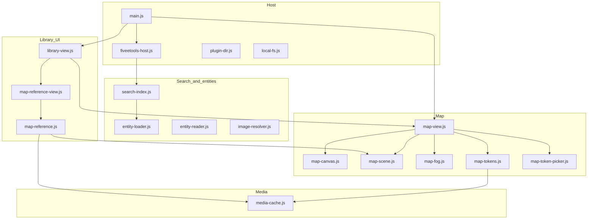

# Module map

The plugin is mostly **ESM functions**, not a class hierarchy. Views subclass Obsidian `ItemView`. Treat this as a module dependency map.

## Views and entry

| Symbol | File | Role |
|--------|------|------|
| `FiveEToolsPlugin` | `obsidian/main.js` | Lifecycle, settings, `ensureReady`, open library |
| `FiveEToolsLibraryView` | `library-view.js` | Main UI: nav, list, tools (map, loot, …). Opens on the DM screen unless that setting is off, which restores the last section. |
| `FiveEToolsView` | `entity-view.js` | Entity preview leaf |
| `FiveEToolsMapPlayerView` | `map-view.js` | Player popout; owns `frame` canvas |
| `FiveEToolsTableView` | `table-view.js` | Table popout; image background, initiative overlay the DM screen card can hide |
| View type ids | `constants.js` | `fiveetools-library`, `fiveetools-preview`, `fiveetools-map-player`, `fiveetools-table` |

## Area map

## Map stack (detail)

| File | Responsibility |
|------|----------------|
| `map-view.js` | GM UI, pointer tools, fog gestures, token drag, `paint` / `paintPlayer`, player bitmaps |
| `map-canvas.js` | Camera math, `drawWorld`, grid/token blit, `bindMapPointer` |
| `map-scene.js` | Vault scene CRUD, layer paths, `scene.json` |
| `map-fog.js` | Fog mask canvas, brush/shapes, PNG save/load |
| `map-tokens.js` | Size footprints, snap, hit-test, create token asset |
| `map-token-picker.js` | Bestiary search modal, drag payload |
| `map-reference.js` | Load `gendata-maps.json`, fetch/cache map images, create scenes |
| `map-reference-view.js` | References → Maps two-pane browser |
| `map-scale.js` / `map-dpi.js` | Cell inches, DPI, actual-size player scale |

## Other areas (short)

| Area | Key files |
|------|-----------|
| Campaigns | `campaign-view.js`, `campaign-store.js`, `campaign-editor.js` |
| Characters | `character-view.js`, `character-store.js`, `ddb-import.js` (public D&D Beyond cards in `{notesFolder}/_characters/{id}.md`; a display name in `snapshot.play` is what the initiative roster shows; campaigns link with `character: id`) |
| Encounters | `encounter-view.js`, `encounter-store.js`, `encounter-difficulty.js`, `encounter-random.js` (Random encounter; roster kind groups + shared initiative / roll-all / reset order; a scaled or edited group stores that stat block on its copies) |
| Encounter size | `encounter-size.js`, `encounter-size-view.js` (level-by-CR monster counts from the XP budget; attack actions set the classic multiplier; Players first discounts the attacks the party spends first) |
| DPR | `dpr-view.js`, `dpr-calc.js` (expected damage charts; spell and attack checkboxes) |
| Simulation | `sim-view.js`, `dpr-sim.js`, `dpr-ai.js` (dice fight; party and encounter controls; added creatures and a saved encounter use the encounter instance roster, and saved-encounter edits are written back; class tactics, Disengage, movement, Wild Shape, and damage adjustments) |
| DM screen | `dm-screen-view.js`, `dm-screen-store.js` (pins, homebrew, campaign notes, encounter card with creature search, saved-encounter menu, and a stat block on hover whose dice can be rolled, quick refs, roll tables, player stat cards, day timeline, dice roller, double-click an initiative row to mark that turn, and again before the round ends unmarks that row, an × on the row removes it, drag a name to reorder and the ruler follows on consecutive numbers, Players places that card’s characters from 20 downward, and a name entered there sits under them, DM adds Enemies at the end, a missing picture shows a shield token; drag a column by the bar at its top, collapse a column sideways or a card up to its title, a card by its header, or a card to the right to start a new column; `{notesFolder}/_dmscreen/board.json`) |
| Dice | `dice-roll.js`, `dice-3d.js`, `dice-3d-lib.js`; Tools → Dice roller via `dice-roller-view.js` + `dice-icons.js` (polyhedral tap-to-roll, adv/disadv). The 3D bundle loads on desktop and mobile from `dice/dice-3d.js` when WebGL is available. The DM screen Dice card uses that same roller, smaller. Non-private rolls also play on the Table popout. |
| Table | `table-view.js`, `table-session.js` (25-to-1 initiative ruler; popout image, ordered names sized from the DM initiative Size slider, width scaling with that size, current turn, 3D dice). Not the map player window. |
| Homebrew | `homebrew-view.js`, `homebrew-store.js` |
| Loot | `loot-view.js` (results via `roll-result-card.js`; treasure type → table ids for creature footer) |
| Random | `random-view.js`, `random-generate.js` (donjon’s 5.5 generator list, ten local rows; the 1d10 is rolled by hand to mark a row; NPCs have a name and a short description; creature, spell, and item links; a marked encounter can be added to the composer) |
| Roll tables | `roll-tables/` (`pasted-table`, `die-ranges`, `table-note`, `table-roll`, `roll-table-store`, `roll-tables-view`), shared `roll-result-card.js` |
| Library rows | `library-row.js` + `spell-meta.js` / `item-meta.js` / `bestiary-meta.js` (CR, rarity, level, type/alignment/habitat, classes; icon sort; spell/item/bestiary filters) |
| Creature stats | `entity-reader.js` + `creature-stat-footer.js` + `creature-scale.js` (Habitat/Treasure on compact monsters; habitat → bestiary filter; treasure link/dice → Loot Generator / roll popup; CR slider scales a copy with the DMG scaler, stores it on the open encounter group, and can save it as new homebrew) |
| Notes / tags | `note-writer.js`, `fivee-tag.js`, `link-suggest.js` |

## Import rules of thumb

- Bundled JSON is read with `vault.adapter` from `plugin.manifest.dir` (ADR 0006). Do not statically import Node `fs` or `path`.
- `map-reference` must not pull `fiveetools-host` in a way that runs before root configure. The desktop catalog uses `getConfiguredAbsoluteRoot()`.
- Player popout cannot `drawImage` main-window `HTMLImageElement`s; use `ImageBitmap` (see ADR 0003).
- Scene tokens live on `scene.tokens` (shared across layers); layer switches must not clear them.
