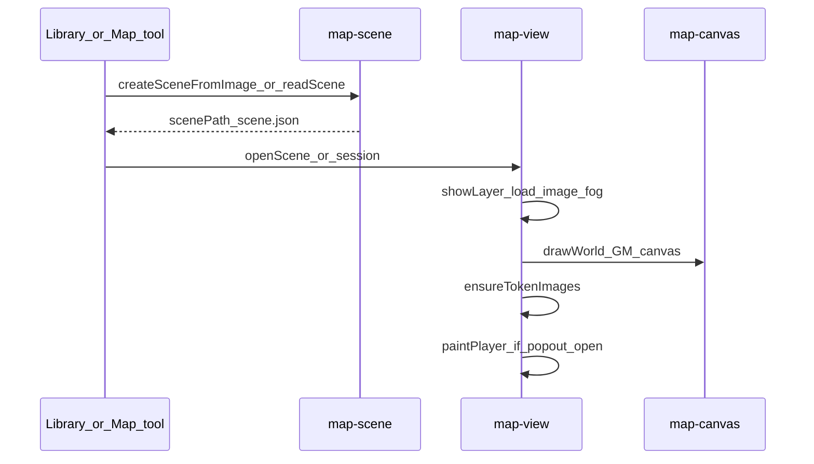
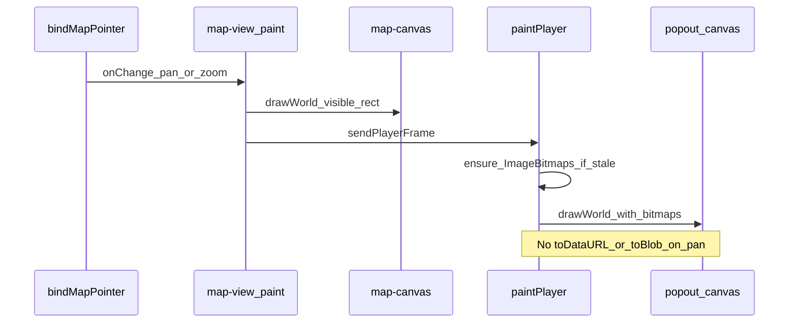
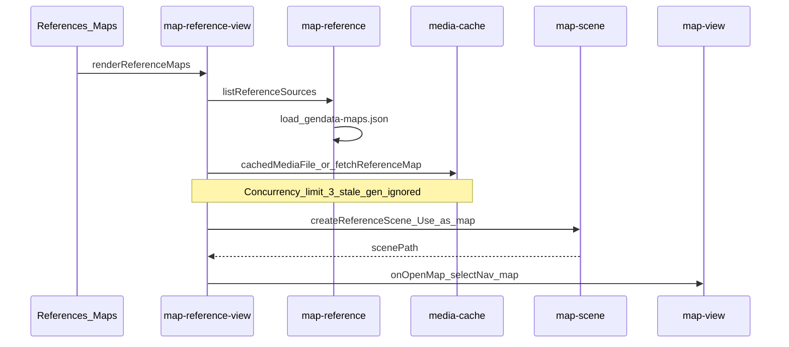

# Core sequences

## 1. Open a map scene



Fit uses layer grid (`cellPx`, offsets) when present; DPI detection must not wipe a pinned index grid.

## 2. Place or drag a token

```mermaid
sequenceDiagram
  participant UI as map-view
  participant Picker as map-token-picker
  participant Tokens as map-tokens
  participant Cache as media-cache
  participant Scene as scene.json
  UI->>Picker: Insert_token_or_drop
  Picker-->>UI: bestiary_doc
  UI->>Tokens: createSceneToken
  Tokens->>Cache: cachedMediaPath_card_image
  Tokens->>Tokens: copy_into_scene_tokens
  Tokens-->>UI: token_record
  UI->>Scene: tokens.push_scheduleSceneSave
  UI->>UI: schedule_paint
  Note over UI: Left-drag updates x_y live; release may snap then save
```

Tokens draw under fog and under the grid in `drawWorld`. Selection ring is GM-only.

## 3. GM pan / zoom with player window open



Map / fog / token-disc bitmaps refresh when those pixels change (layer load, fog commit, new token size), not on every pan.

## 4. Reference map browse and use



Index path is `getConfiguredAbsoluteRoot()/data/generated/gendata-maps.json` in the **installed** plugin, not the git tree. That absolute path exists on desktop only.
